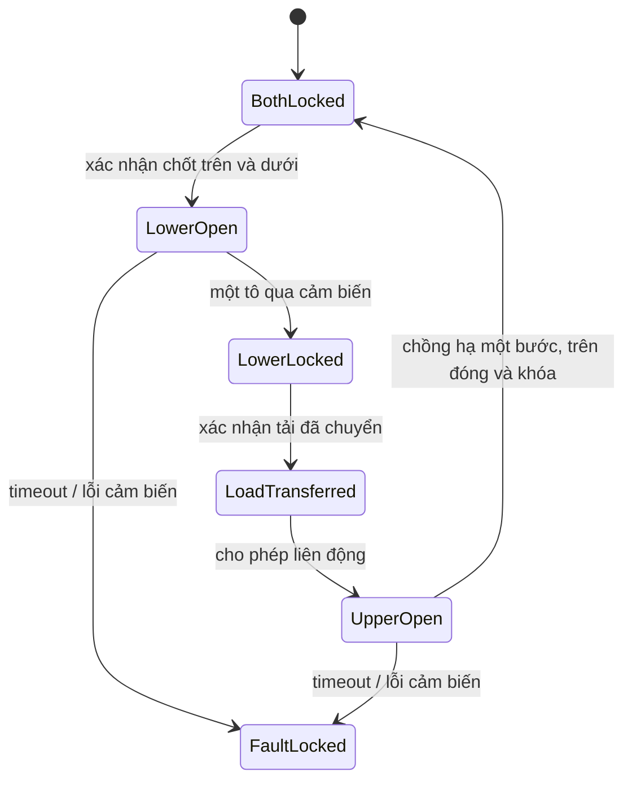

# Prototype chuyển động cánh quay — một cột

Trạng thái: prototype khái niệm để chuyển sang CAD động học; không phải bản vẽ sản xuất. Phạm vi: một cột, hai tầng giữ tô đồng trục, sáu cánh quay mỗi tầng, một servo MG996R 360° mỗi tầng. Bước lồng, biên dạng gờ tô và bán kính trục cánh cần đo/cập nhật trước khi chốt kích thước.

## Cơ cấu đề xuất

- Mỗi cánh là một đòn bẩy có bản lề đứng ở phía ngoài và một gờ đỡ vành tô ở phía trong. Cánh đóng nằm dưới gờ tô; cánh mở quay ra ngoài để giải phóng miệng tô.
- Sáu cánh cùng tầng được nối bằng một vòng đồng bộ quay giới hạn góc, qua thanh nối ngắn hoặc bánh răng cung tại bản lề. Vòng này là truyền động quay, không phải cam; servo đặt lệch bên và dẫn động vòng qua bánh răng/đai giảm tốc.
- Cơ cấu chặn cơ giới hạn hai đầu. Công tắc mở/đóng độc lập dừng servo; PWM chỉ ra lệnh quay trái/phải/tốc độ, không xác định góc. Lò xo/chốt cơ giữ tầng đóng khi mất điện; không dựa vào servo giữ tải.
- Hai tầng làm việc luân phiên: đóng và khóa cả hai → tầng dưới mở, nhả một tô → tầng dưới đóng và xác nhận khóa → xác nhận tầng dưới đã nhận phần chồng còn lại → tầng trên mới được mở/đóng lại để hạ chồng một bước → xác nhận tầng trên khóa → lặp. Tầng trên giữ bốn tô trong chu kỳ bình thường; tầng dưới giữ một tô trước khi nhả.

## Hình học đã dựng trong FreeCAD

- Bản gia cường PETG hiện rộng Ø320 mm; carrier dày 8 mm. Bốn trụ kết cấu kim loại Ø12 mm PCD276 mm.
- Bốn trụ dẫn kim loại Ø12 mm PCD292 mm, cao 436 mm (z=−28…408 mm); đưa ra ngoài vùng quét cánh, mỗi cột mang 5 guốc theo bao hình ước lượng.
- Mỗi trụ dẫn mang năm tay đỡ và guốc theo biên dạng nón ước lượng, tại cao độ giữa thân mỗi package. Khe hướng kính danh nghĩa 3,5 mm, còn 0,5 mm khi chỉnh trụ vào hết 3 mm. Các guốc là mô hình hình học để giữ/định hướng, chưa thay thế con lăn hoặc vật liệu đệm.
- Tâm bản lề ở bán kính 114 mm; cánh quay 90°.
- Mỗi tầng có một vòng đồng bộ có 6 tay, 6 thanh nối dài theo hình học tính toán và 6 chốt kéo Ø4 mm; tâm chốt vòng đặt R=103 mm để tăng khe hở với nắp. Vòng đặt cao hơn 2 mm (z+20) để dành mặt phẳng link riêng.
- Vòng răng ngoài 72 răng ăn khớp pinion 12 răng (tỷ số 6:1). Với tâm chốt vòng R=103 mm, hình học 4 khâu cho link khoảng 16,88 mm, vòng quay khoảng −4,51° và pinion khoảng +27,04° cho hành trình cánh 90°. Tooth profile vẫn là hình thang giản lược, không phải biên dạng involute.
- Aperture đóng theo bao hình cánh khoảng Ø166,7 mm; trạng thái mở khoảng Ø204 mm, vượt mục tiêu thông Ø200 mm trên geometry ước lượng.
- Cánh PETG dày đứng 8 mm, rộng tiếp tuyến 26 mm; mỗi bản lề có bearing 625-2RS OD16/ID5/W5 và pin thép Ø5 mm. Package envelope L1: thân Ø175,7 mm × 70 mm, nắp ước lượng Ø181,7 mm, nhô cao 5 mm. Khoảng cách tầng 75 mm vẫn là giả định cho đến khi đo 10 package.
- Đã dựng tháp chốt khóa lò xo Ø6 mm, bạc lót thép OD8/ID6,2 và tai trên vòng; tháp bắt bằng 2 bu-lông M5 xuyên carrier. Mô hình pin rút ở file mở, pin gài ở file đóng. Chốt chặn/công tắc hành trình, actuator rút khóa và servo vẫn cần chi tiết lắp thật; không dùng mô hình pin làm chứng nhận khóa.

## Torque screening theo thông số servo

TowerPro công bố stall torque MG996R 11 kgf·cm tại 6 V và 9,4 kgf·cm tại 4,8 V ([TowerPro](https://towerpro.com.tw/product/mg996R/)). Quy đổi `1 kgf·cm=0,0980665 N·m`: `T_stall,6V=1,079 N·m`; `T_stall,4.8V=0,922 N·m`. Vì nhà cung cấp không cho torque liên tục, dùng hệ số giảm 4 cho screening: `T_servo,screen=T_stall/4`, lần lượt **0,270 N·m ở 6 V** và **0,231 N·m ở 4,8 V**. Đây không phải torque định mức liên tục. Biến thể 360° người dùng sở hữu có thể khác; cần đo đúng servo.

Ước lượng bảo thủ để cánh quét ngang dưới gờ đang chịu tải: `T_sweep≈μ_s W_d R_eff`; dùng `R_eff=87,85 mm` (bán kính vành tô), tải thiết kế `W_d=3mg` và chưa cộng ma sát bản lề, chốt, truyền động hay kẹt. Với `μ_s=0,2` giả định:

| Tình huống | `W_d` | `T_sweep` | Tỷ số `T_sweep/0,270` ở 6 V |
|---|---:|---:|---:|
| Tầng dưới, 1 tô | 29,43 N | 0,517 N·m | 1,92 |
| Tầng trên, 4 tô | 117,72 N | 2,068 N·m | 7,66 |
| Lỗi, 5 tô ở một tầng | 147,15 N | 2,585 N·m | 9,57 |

Nếu `μ_s=0,4`, torque ước lượng gấp đôi. Vì vậy prototype phải **dỡ tải khỏi tầng trước khi cánh quét mở**; tải trên bình thường phải được nhận bởi tầng còn lại. Nếu không dỡ tải, direct-drive một servo không đạt theo screening. Gearing có thể giảm torque yêu cầu ở servo nhưng không giảm lực tiếp xúc và cần kiểm hiệu suất/độ rơ.

## Tăng số cánh và ma sát

Với `n` cánh chia đều tải đứng `W`, tải trung bình từng cánh giảm theo `N_i≈W/n`. Mỗi điểm có thể chịu ít hơn, và vành tô được đỡ với nhịp ngắn hơn. Nhưng tổng ma sát Coulomb lý tưởng vẫn `F_f=ΣμN_i=μW`; tăng `n` không tự giảm tổng lực ma sát nếu `μ`, tổng tải và hướng trượt giữ nguyên. Tăng số cánh còn tăng bản lề, điểm cọ, preload và sai lệch lắp, nên ma sát thực có thể tăng. Dùng vòng bi/đổi hướng chuyển động có thể giảm lực kéo, nhưng phải đo.

## Điều kiện đóng prototype

1. Đo 10 tô: khối lượng, đường kính vành, mặt cắt gờ, bước lồng; cập nhật vị trí hai tầng và hành trình cánh.
2. Chốt hình học trục bản lề, chiều dài cánh tay đỡ và điểm nối vòng đồng bộ; tính moment mỗi cánh từ lực đo/lệch tâm.
3. Tạo CAD trạng thái đóng/mở cho 12 cánh; kiểm giao thoa, vùng lồng tô, servo, cảm biến và chốt.
4. Tính bản lề/trục/vòng/bu-lông theo tải `K=3`, trường hợp 3 cánh chia tải và trường hợp hỏng lệch tâm 1–2 cánh; ghi `SF=allowable/stress` cho từng chi tiết với vật liệu thực.
5. Đo điểm dừng PWM riêng cho từng servo và đo torque–tốc độ/nhiệt. Có limit switch kép, timeout, dừng lỗi và khóa cơ mất điện.
6. In coupon/cánh thử để kiểm lắp; tải tĩnh, creep 72 h, lệch tâm, mất điện và chu kỳ FIFO trước khi thiết kế release.

Thiết kế gia cường PETG và bảng tải sơ bộ được ghi riêng trong [petg_reinforced_prototype.md](petg_reinforced_prototype.md). Các phép tính là sàng lọc danh nghĩa, không cung cấp allowable PETG hay hệ số an toàn cuối.
